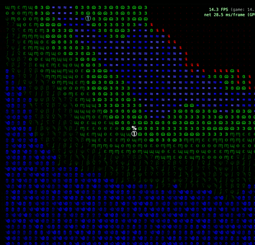

# Thunder Lizard, imagined by a neural net

Can a small neural net learn a game well enough that you can play it **inside the net**, with no game engine running at all?

<p align="center">
  
  <br><em>Every frame here is drawn by the model. It sees the last few frames and the key you're pressing, and predicts the next one.</em>
</p>

**▶ Play it in your browser: [thunder-lizard-frame-prediction.vercel.app](https://thunder-lizard-frame-prediction.vercel.app/)** (best in Chrome or Edge; runs on your GPU via WebGPU)

This is an early, open learning project: I'm new to machine learning, and this repo is where I try ideas, keep score, and write down what worked and what didn't.

## The original game

<p align="center">
  
  
</p>

[**Thunder Lizard: Eat or Be Eaten**](https://enegames.itch.io/thunder-lizard-eat-or-be-eaten) is an ASCII game I made: you're a dinosaur on a volcanic island. Eat smaller dinos, avoid bigger ones, and stay ahead of the spreading lava. The game lives in [`game/`](https://github.com/jschomay/thunder-lizard) (a submodule).

## How it works

1. **Record.** A headless version of the game is played by bots for hundreds of thousands of ticks. Every tick is saved as a 45×45 grid: one layer for terrain (ocean, water, dirt, grass, shrub, jungle, lava, burnt) and one for entities (the player and the dinos, with their facing and level, plus skeletons), along with the key pressed.
2. **Train.** A convolutional net (a CNN with a U-Net branch, about 600k parameters) learns: *given the last 4 frames and a key, what's the next frame?*
3. **Play.** In the browser, the model runs in a loop on its own output. The first frames come from a real game; everything after that is the net's imagination. Code only turns the model's output into a frame (picking or sampling each cell) and draws it.

This makes it a small **world model**, or neural game engine: the same idea as [GameNGen](https://gamengen.github.io/) (DOOM inside a diffusion model) and Genie, at toy scale on a laptop.

**Ground rules I set for the project:** the net should predict frames, not run a game behind the scenes. So fixes have to come from the model and its training, not from game logic added to the code. It's also fine for the imagined game to drift away from the real one, as long as it still feels like the game.

## What we're trying

Each idea is written up as a hypothesis, tested, and scored:

- **[HYPOTHESES.md](HYPOTHESES.md):** every idea with its status (🟢 supported, 🔴 refuted, 🟡 open) and the evidence.
- **[JOURNAL.md](JOURNAL.md):** the lab notebook: each run, its numbers, the surprises, the mistakes and the decisions.

Some highlights so far:

| Idea | Result |
|---|---|
| More history (4 frames vs 1) | 🟢 needed: the player moves every other tick, which one frame can't show |
| "Copy the last frame by default" | 🟢 much faster learning; exact frames 47% vs 10% |
| Split "what's here" from "facing / level" | 🟢 the player stopped vanishing |
| Predict each dino's *fate* (stay / move / die) | 🟢 dinos stopped duplicating and vanishing |
| A recurrent memory (ConvGRU) for continuity | 🔴 no gain: training barely rewards remembering |
| Masked diffusion, drawing each frame in passes | 🔴 1–2 points at 4× the compute |
| Damaging the input frames during training (GameNGen-style) | 🟡 fewer stray cells, but dinos got worse |
| A transformer with long history | 🟡 next up |

Every model is compared on a fixed **scorecard** ([`tlfp/scorecard.py`](tlfp/scorecard.py)) of things that matter for play, not just accuracy:
- **Continuity:** walk away and come back. Is it the same place?
- **Smear:** does one terrain type slowly take over the screen?
- **Static:** stray single cells.
- **Scrolling:** does the view move when you press a key?
- **Dino movement.**
- **Speed:** milliseconds per frame.

The biggest open gap is **continuity**: the model forgets places once they scroll off screen (70% vs 95% in the real game).

## Repo layout

| Path | What's there |
|---|---|
| `tlfp/` | Python: model, training, rollouts, scorecard, export to ONNX |
| `harness/` | Bot players that record training data from the headless game |
| `app/` | The browser app ([live](https://thunder-lizard-frame-prediction.vercel.app/)): ONNX Runtime Web on WebGPU, ~16 ms per frame |
| `.whiteboard/` | Interactive explainer pages used while working: how the model works, inside the layers, predictions, diffusion, and more |
| `scorecards/` | Scorecard results per model |

## Running it

```bash
uv sync
# record data (from game/, see harness/record.ts for scenarios)
cd game && npx vite-node --root .. ../harness/record.ts -- --stage 3 --episodes 200 --ticks 500
# train
uv run python -m tlfp.train --data data/stage3-100k --k 4 --copy-prior --split-entity --fates --unet --dino-weight 20 --name my-run
# score, then export to the browser app
uv run python -m tlfp.scorecard checkpoints/my-run-last.pt --eps 24
uv run python -m tlfp.export_onnx checkpoints/my-run-last.pt
cd app && python3 -m http.server
```

Training runs on a Mac (Apple GPU) in about 20 minutes per 3 epochs. Runs are logged to Weights & Biases.

Built with a lot of help from Claude (Claude Code).
